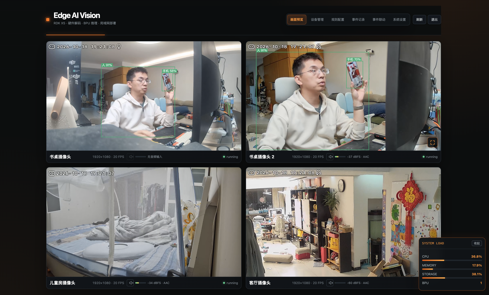
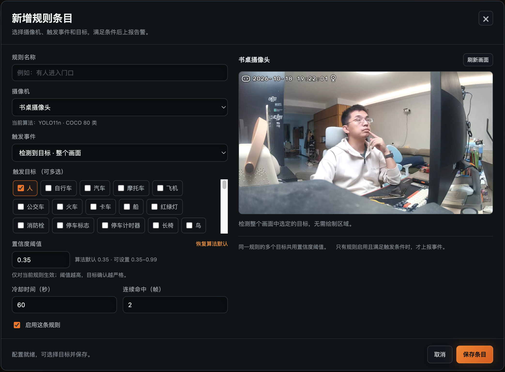
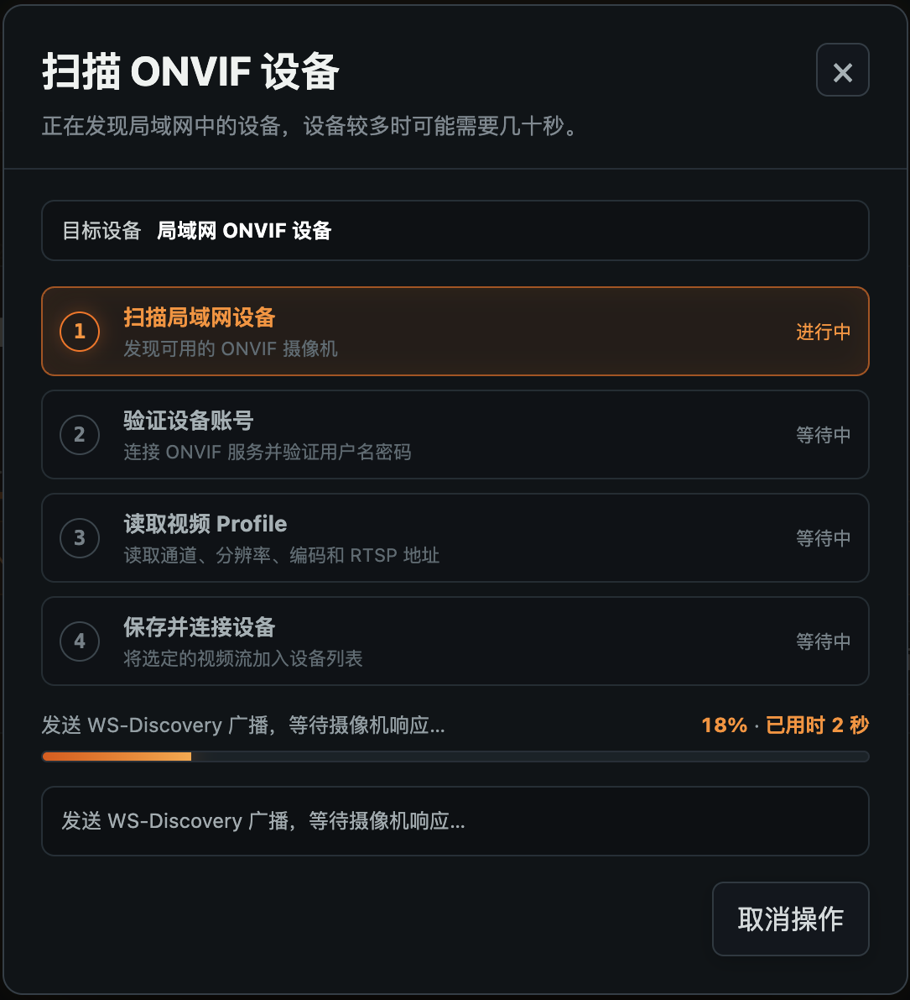
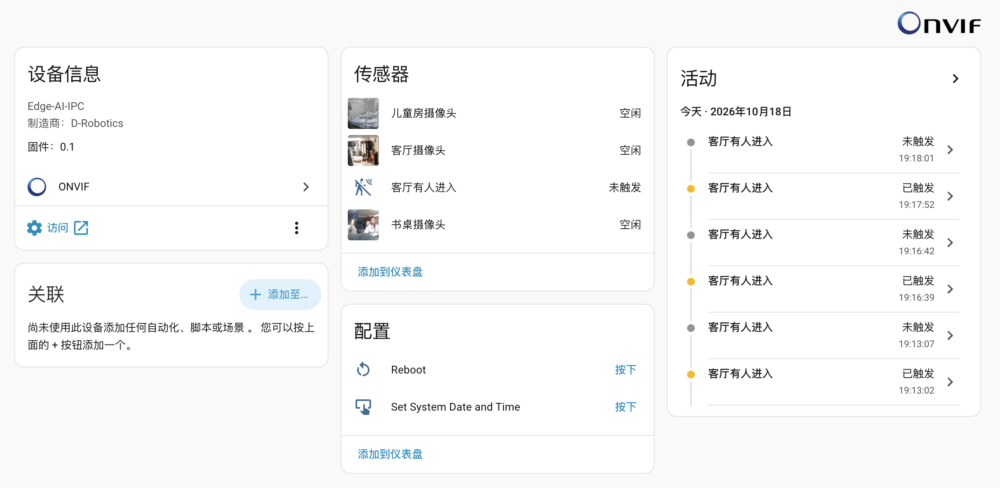
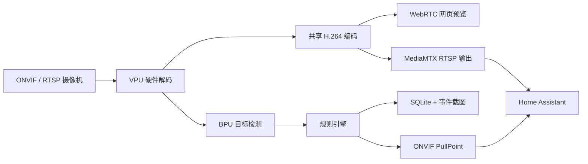

# AIX5 · Edge AI Vision

基于 **D-Robotics RDK X5** 的局域网 AI 视频分析应用。接入网络摄像机，在本地完成硬件解码、目标检测、区域规则判断和事件截图，并通过 ONVIF 将视频与告警接入 Home Assistant。

## 快速上手

已完成安装后，在同一局域网访问 `http://<开发板IP>:8080`。首次部署请先阅读 [安装与运维指南](docs/deployment.md)。

| 项目 | 默认值 / 使用方式 |
|---|---|
| Web / ONVIF HTTP 端口 | `8080` |
| ONVIF 设备名称 | `Edge-AI-IPC` |
| ONVIF 服务 | `http://<开发板IP>:8080/onvif/device_service` |
| RTSP 输出 | `8554/TCP`，各路地址由 ONVIF 自动提供 |
| 新安装用户名 | `admin` |
| 新安装密码 | 首次启动随机生成，查看数据目录中的 `initial-admin.txt` |
| 显示时区 | 东八区，`Asia/Shanghai` |
| 视频软件回退 | 默认关闭；在系统设置中显式开启 |

本地运行默认数据目录为 `./data`：

```bash
cat ./data/initial-admin.txt
```

使用本文 systemd 安装方式时，默认数据目录为 `/var/lib/aix5-ai`：

```bash
sudo cat /var/lib/aix5-ai/initial-admin.txt
```

已有安装升级会保留原账号，不会重置密码。Web / ONVIF 使用应用账号；SSH 使用你为开发板设置的系统账号。

1. **添加摄像机**：在“设备管理”中扫描 ONVIF 设备，或填写 RTSP 地址；拖动设备前的手柄可调整预览顺序。
2. **选择检测类别**：打开设备的“AI 显示”，选择需要检测的目标，支持分组全选和全局全选。
3. **建立规则**：在“规则配置”点击“新增条目”，选择摄像机、触发事件、目标和阈值；区域规则可直接在画面上绘制矩形或多边形。
4. **查看事件**：事件记录按系统设置中的时区显示，保存截图，可选择保留 3、7 或 30 天。
5. **接入 Home Assistant**：添加 ONVIF 集成，填写开发板 IP、端口 `8080` 和应用账号。需要规则名称与删除同步时，安装 [Edge AI ONVIF Rule Sync](home_assistant/README.md)。

## 画面预览

支持多路画面、中文检测框、输入音量和每路独立静音控制。AI 分析默认上限为每路 5 FPS，视频播放按摄像机实际输入帧率独立运行。



## 功能

| 能力 | 说明 |
|---|---|
| 摄像机接入 | ONVIF WS-Discovery 扫描、账号验证、Profile 选择，或直接添加 RTSP；支持 H.264 / H.265 输入 |
| 硬件处理 | RDK VPU 视频解码与 H.264 编码，BPU 运行 YOLO11n / YOLO11m；硬件初始化支持重试 |
| 检测类别 | COCO 80 类，按摄像机启用；默认人、猫、狗 |
| 网页预览 | WebRTC H.264 + Opus；1920×1080 / 960×540 可选，全屏使用源尺寸；同路同模式共享编码 |
| 音频 | 探测源音频编码、解码并显示输入等级；各路独立开关，默认静音 |
| 规则 | 整幅画面或区域检测、多目标、置信度、连续命中、冷却和清除时间；新规则置顶 |
| 本地事件 | 事件与 JPEG 截图，3 / 7 / 30 天保留、容量覆盖、JSON / CSV 导出；不录像 |
| 系统设置 | 预览分辨率、软件回退、事件保留、时区和单用户账号修改 |
| Home Assistant | 一台 ONVIF 网关提供多路视频和规则传感器，无需 MQTT Broker |

### 规则配置

每条规则对应一个传感器。同一规则的多个目标合并状态，只有正式触发规则后才上报告警，最后一个有效目标清除后复位。规则名称可以修改，传感器实体 ID 保持稳定。

新规则的默认阈值来自当前算法配置，现有 YOLO11n / YOLO11m 为 **0.35**；已有规则继续保留自己的阈值。检测算法已过滤的低分目标无法在规则层恢复，因此新设置的规则阈值不得低于算法下限。



### ONVIF 设备添加

扫描、验证账号、读取视频 Profile 和保存连接分别显示进度。等待过程中可以取消。

<p align="center">
  
</p>

## 硬件与运行环境

| 项目 | 参考配置 / 要求 |
|---|---|
| 开发板 | D-Robotics **RDK X5** |
| CPU 架构 | ARM64 / aarch64，8 核 Cortex-A55 |
| 内存 | 参考开发板为 **8 GB** |
| 存储 | 参考开发板为 **32 GB TF 卡**；事件截图占用受保留天数和容量上限控制 |
| 操作系统 | **RDK OS 3.5.0 / Ubuntu 22.04.5** |
| Python | **3.10+** |
| 硬件运行时 | RDK OS 提供的 `hbm_runtime`、`hb_media_codec`，部分码流兼容路径使用 `libspcdev` |
| 模型 | 面向 RDK X5 编译的 YOLO11n / YOLO11m `.bin` 模型，不随仓库分发 |
| 摄像机 | 局域网 RTSP 或 ONVIF 摄像机；分辨率、帧率和编码 Profile 必须在板端解码能力范围内 |
| 其他依赖 | FFmpeg / FFprobe、MediaMTX Linux ARM64；浏览器支持 WebRTC |

以上是参考环境，不代表所有硬件组合的性能保证。完整 BPU / VPU 功能需要在 RDK X5 上运行；普通开发机可运行控制面和自动化测试。

官方资料：[RDK X5 文档](https://developer.d-robotics.cc/rdk_x_doc/RDK?v=3.5.0&p=RDK+X5) · [RDK 摄像机显示示例](https://developer.d-robotics.cc/rdk_x_doc/Basic_Application/pydev_demo_sample/RDK_X5/web_display_camera_sample?v=3.5.0&p=RDK+X5)

## 安装

在 RDK X5 上准备系统 SDK 与模型，进入项目目录后：

```bash
# 让虚拟环境访问 RDK OS 自带的硬件 Python 运行时
python3 -m venv --system-site-packages venv
source venv/bin/activate
python -m pip install -e .

# 安装固定版本的 ARM64 RTSP 服务，脚本校验 SHA-256
bash deploy/install-mediamtx.sh
```

然后按 [安装与运维指南](docs/deployment.md) 编译原生采集器、编码器，并设置开发板的局域网地址：

```bash
export AIX5_DATA_DIR="$PWD/data"
export AIX5_BASE_URL="http://<开发板IP>:8080"
aix5-ai
```

将 `<开发板IP>` 替换为真实 IP。`AIX5_BASE_URL` 用于首次初始化媒体和事件地址，已有安装使用数据库中保存的 `base_url`；地址变更方式见部署指南。

默认 Web 监听 `0.0.0.0:8080`。开机自启使用可配置的 [systemd 安装脚本](deploy/install.sh)，安装前可运行 `--dry-run` 查看生成的服务配置。

## Home Assistant

在 Home Assistant 中添加 **ONVIF**，填写：

| 字段 | 值 |
|---|---|
| 主机 | 开发板局域网 IP |
| 端口 | `8080`，ONVIF HTTP 服务端口 |
| 用户名和密码 | AIX5“系统设置 → 登录账号”中的账号 |
| 设备 | `Edge-AI-IPC` |

RTSP 端口 `8554` 由网关自动提供，不填入 ONVIF HTTP 端口栏。源摄像机的账号由网关管理，HA 使用 AIX5 账号访问输出流。



**规则动态同步需要配套组件。** 原生 ONVIF 集成可以自动新增事件传感器，但当前 HA 不会自动使用规则名称或移除已删除规则的实体。安装 [Edge AI ONVIF Rule Sync](home_assistant/README.md) 并选择已有网关后，组件会同步名称和删除；告警状态、视频和音频仍由原生 ONVIF 接收。

- 新增规则自动生成传感器，改名保留实体 ID，删除规则移除对应实体。
- 停用规则保留实体并清除告警；一条多目标规则仍只对应一个传感器。
- 同步使用完整 ONVIF 规则目录，网络或认证失败时保留现有实体。
- 组件复用原生 ONVIF 的设备账号，不需要额外 HA API Token。

| 播放端 | 视频 | 音频 |
|---|---|---|
| 网页 WebRTC | H.264 | Opus |
| Home Assistant / RTSP | H.264 | AAC，48 kHz 单声道 |

无音频输入时只提供视频轨道。已有部署升级后，成功登录一次 AIX5 网页即可初始化严格的 ONVIF 摘要凭据。兼容性已在 HA Core 2026.10.0 中验证；本项目未声明获得 ONVIF Profile S/T 认证。

## 架构与目录



详细设计见 [技术架构设计](AI视频分析应用-技术架构设计.md)。

```text
aix5_ai/          应用、媒体管线、规则、存储、ONVIF 与网页界面
native/           RDK X5 原生采集器和硬件编码器源码
home_assistant/   规则名称与实体删除同步组件及安装说明
deploy/           systemd 模板、安装脚本、MediaMTX 安装器
tests/            自动化回归测试
tools/            可复用的板端和 HA 验证工具
img/              README 展示图片
docs/             公开安装指南；本地诊断报告由 .gitignore 排除
```

## 设置与数据

- **时区**：默认东八区 `Asia/Shanghai`，事件显示为 `2026年10月18日 16时30分05秒`，原始记录和 ONVIF 时间使用 UTC。
- **分辨率**：默认 `960x540`，可切换为 `1920x1080`；网页和 HA 的输出遵循相同全局配置。
- **视频软件回退**：默认关闭，硬件不可用时重试并报错；启用后允许软件处理，可能降低可用通道数或播放性能。
- **事件保留**：默认 7 天，可选 3 / 7 / 30 天；默认截图容量上限 2048 MB。
- **账号**：一个应用账号，密码使用 Argon2；用户名与密码在系统设置中修改。
- **备份**：持久数据包括数据库、事件截图和 `.onvif-secret.key`。ONVIF 加密凭据恢复需要数据库与密钥配对。

应用面向可信局域网，默认 HTTP 与 RTSP 不提供传输层加密。运行时配置、账号、摄像机 URL、数据库和事件截图应保存在数据目录；这些内容不属于源码仓库。

## 开发与验证

```bash
python3 -m venv .venv
source .venv/bin/activate
python -m pip install -e '.[dev]'
python -m pytest -q
```

测试使用临时数据库和模拟硬件，并包含本机 WebRTC 协议验证。真实 VPU 编解码和 BPU 推理需在板端验证。仓库保留测试源码与可复用工具，排除中间输出、实测快照、阶段报告和本地环境说明。

```bash
# RDK X5：合成帧编码与背压恢复，无需摄像机凭据
python tools/verify_native_stream.py
python tools/verify_native_backpressure.py
```

更多操作见 [安装与运维指南](docs/deployment.md) 和 [HA 组件说明](home_assistant/README.md)。

## 当前边界

- 面向最多 4 路摄像机的应用配置，实际吞吐取决于输入分辨率、帧率、编码 Profile、所选模型和观看连接数；不保证所有组合满帧。
- 多观看连接下 WebRTC 仍可能掉帧，AI 分析频率与视频播放频率分开配置。
- 特定 H.264 / H.265 码流可能超出 VPU 能力；默认不会隐式转为软件视频编解码。
- 烟火 / 烟雾模型尚未接入已验证的推理链，不能作为现成功能使用。
- HA 可能自动生成重启、校时等按钮，当前未实现的 ONVIF 操作会返回不支持错误。
- MQTT 仅保留旧部署兼容后端，新的界面与集成流程使用 ONVIF。

## 许可

项目采用 [MIT License](LICENSE)。MediaMTX 的许可保留在 [native/LICENSE.mediamtx](native/LICENSE.mediamtx)。板载 SDK、模型和其他依赖遵循各自许可，不随本仓库提供。
